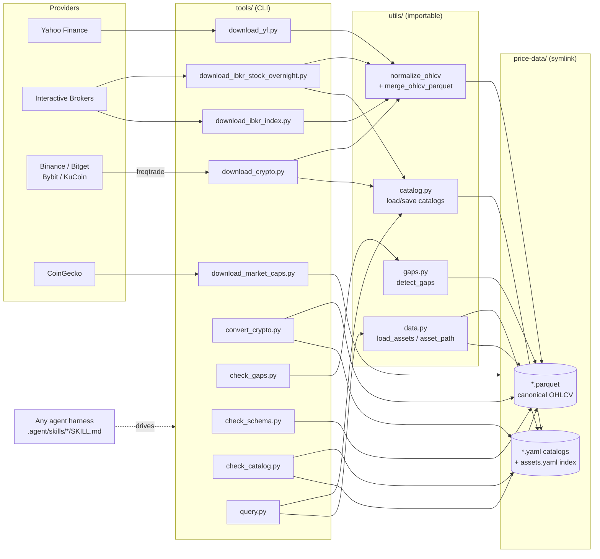

# ai-data-manager

A price-data management workspace: it downloads, normalizes, catalogs, and
audits OHLCV (and related) time-series data across asset classes and
providers, then exposes it through a small importable Python API, a set of
CLI tools, and Claude Code agent skills.

```
5,019 catalogued symbols · 6 providers · 7 asset classes · ~22 GB on disk
```

## What's in here

| Asset class | Providers | Universes |
|---|---|---|
| Stocks | YF, IBKR | sp500 (503), nasdaq100 (110), russell2000 (1,917), delisted_stocks (27) |
| Crypto (spot) | Binance, Bitget, Bybit, KuCoin | 435 / 796 / 94 / 908 symbols |
| Crypto (futures) | Binance, Bybit, KuCoin | 71 / 71 / 74 symbols |
| Indexes | YF | DJI, GSPC, IXIC, NDX, RUT, VIX… (11) |
| Commodities | YF | GC=F (Gold) |
| Macro | YF | WTB3MS (3-month T-bill) |
| Market-cap | CoinGecko | snapshot/history exports (not per-symbol OHLCV, not in `assets.yaml`) |

Counts as of the last catalog scan — see [`docs/data-model.md`](docs/data-model.md)
for how to reproduce them (`tools/query.py --list-exchanges`, YAML entry counts).

## Quick start

```bash
# Always use the project venv — never system Python
uv sync                              # install deps into .venv/
uv run python tools/status.py                # what exists, what's stale

# See what's stale — every asset class, each against its own trading calendar
uv run python tools/check_gaps.py --all-catalogs

# Verify every OHLCV file matches the canonical schema
uv run python tools/check_schema.py

# Verify the catalog describes those files correctly
uv run python tools/check_catalog.py
```

```bash
uv run pytest                        # test suite — no network, no price-data/
```

See [`CLAUDE.md`](CLAUDE.md) for the Python-environment rule,
[`AGENTS.md`](AGENTS.md) for the full data-convention reference this README
summarizes, and [`ROADMAP.md`](ROADMAP.md) for the current work plan and known
gaps.

## Architecture at a glance



Full breakdown, directory tree, and the provider-first path rule are in
[`docs/architecture.md`](docs/architecture.md).

## Documentation index

| Doc | Covers |
|---|---|
| [`docs/architecture.md`](docs/architecture.md) | System diagram, directory layout, provider-first path rule, catalog resolution |
| [`docs/data-model.md`](docs/data-model.md) | Canonical OHLCV schema, catalog YAML shapes (flat vs. nested-by-provider), asset class coverage |
| [`docs/cli-reference.md`](docs/cli-reference.md) | Every tool in `tools/`, full argument reference with examples |
| [`docs/workflows.md`](docs/workflows.md) | End-to-end task walkthroughs (crypto refresh, IBKR download, market-cap snapshots, schema audits) |
| [`docs/agentic-usage.md`](docs/agentic-usage.md) | How any agent harness drives this repo, `.agent/skills/` conventions, example prompts |
| [`AGENTS.md`](AGENTS.md) | Canonical, terse data-convention reference (source of truth; docs/ expands on it) |
| [`ROADMAP.md`](ROADMAP.md) | Sequenced work plan: what's fixed, what's known-missing, and why |

## Repository layout

```
ai-data-manager/
├── .agent/              # Agent skills (skills/<name>/SKILL.md + frontmatter)
├── docs/                # This documentation set
├── tools/               # Standalone CLI scripts (uv run python tools/<x>.py)
├── tests/               # pytest suite
├── utils/               # Shared importable Python modules
├── price-data/          # Symlink → ../price-data/ (data + YAML catalogs)
├── CLAUDE.md            # Claude Code project instructions (env rule, pointer)
├── AGENTS.md            # Full data conventions & tool reference
├── ROADMAP.md           # Work plan and known gaps
├── .env.example         # Every machine-specific setting
└── pyproject.toml
```

## Adding to this repo

- New CLI tool → drop it in `tools/`, add a row to the table in `AGENTS.md`
  and (if it's a common task) an example in `docs/cli-reference.md`.
- New agent skill → add `.agent/skills/<name>/SKILL.md` with frontmatter, register it
  in `AGENTS.md`'s Agent Skills table. See
  [`docs/agentic-usage.md`](docs/agentic-usage.md).
- New provider or asset class → follow the provider-first path rule in
  [`docs/architecture.md`](docs/architecture.md) before writing any files.
