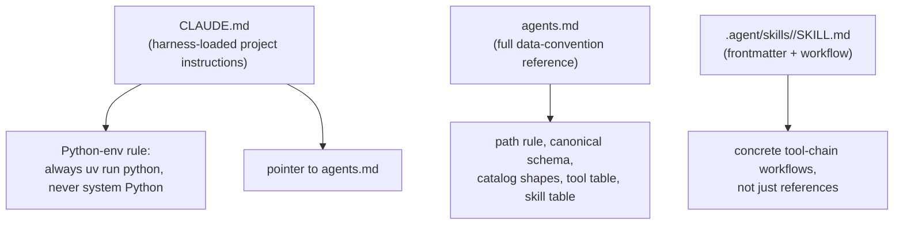

# Agentic usage

This repo is designed to be operated by Claude Code (or another
Claude-Agent-SDK-based coding agent) as much as by a human at a terminal.
This doc covers how that's wired up and how to extend it.

## The three files an agent reads first



- **`CLAUDE.md`** — auto-loaded into every Claude Code session in this repo.
  Kept short on purpose: the one hard rule (venv, never system Python) and a
  pointer to `AGENTS.md` for everything else. It used to restate the layout and
  data root, which is exactly the duplication that drifts.
- **`AGENTS.md`** — the terse, authoritative reference: layout, the
  provider-first path rule, canonical schema, catalog shapes, the tools
  table, and the agent-skills table. Treat this as source of truth; the
  `docs/` set expands on it with diagrams and worked examples but never
  contradicts it.
- **`.agent/skills/<name>/SKILL.md`** — one directory per **skill**: a named,
  reusable workflow an agent can execute end-to-end (tool chain + standard
  invocations + gotchas), as opposed to `AGENTS.md`'s reference-style tables.
  YAML frontmatter (`name`, `description`) makes it discoverable by scanning,
  so no harness depends on a human having read the table. Point a harness at
  it with `ln -s ../.agent/skills .claude/skills` — the layout the sibling
  `py-qwant` repo uses.

## Skills currently defined

| Skill | File | Covers |
|---|---|---|
| `crypto_download` | [`.agent/skills/crypto_download/SKILL.md`](../.agent/skills/crypto_download/SKILL.md) | Identify stale/missing crypto data → download via freqtrade → merge without duplicates → keep the catalog in sync |

See [`docs/workflows.md#crypto-refresh`](workflows.md#crypto-refresh) for the
same workflow with a diagram.

## Driving this repo with an agent

Typical prompts and what the agent should reach for:

| You ask | Agent should |
|---|---|
| "Refresh binance daily and 4h data" | Run the `crypto_download` skill: `check_gaps.py` → `download_crypto.py` → `query.py` |
| "What's the state of the data?" | `tools/status.py --json`, then `--deep` if anything looks off |
| "Is anything stale?" | `tools/check_gaps.py --all-catalogs --json` — every asset class, each against its own trading calendar |
| "Add SOL/USDT going back to 2020" | `download_crypto.py --pairs SOL/USDT --full --since 2020-01-01` across the timeframes you need |
| "Refresh the daily stock/index data" | `download_yf.py --universe sp500 --timeframes 1d`, then `check_catalog.py` |
| "Pull fresh sp500 intraday bars from IBKR" | Confirm TWS/Gateway is running first, then `download_ibkr_stock_overnight.py --universe sp500 ...` |
| "Pull IBKR intraday bars for the indices" | `download_ibkr_index.py --timeframes 1h --since 2024-01-01` (TWS/Gateway first) |
| "Some IBKR symbols failed overnight" | `retry_ibkr_failed_sequentially.py --universe <u> --timeframes ...`, reading `tmp/ibkr_stock_progress_*.json` |
| "Does everything match the canonical schema?" | `check_schema.py`, then `convert_crypto.py` for any crypto mismatches |
| "Is the catalog telling the truth?" | `check_catalog.py --json`; `--fix` for the mechanical classes |
| "Is this price series adjusted?" | Read `adjustment` off the catalog node — don't infer it from the provider |
| "What's the market cap of the top 20 alts monthly?" | `download_market_caps.py --all-active --frequency monthly --top-n 20 ...` |

Every audit tool takes `--json`, so none of this needs table-scraping:
`status.py` for the roll-up, `query.py` for per-series detail, `check_gaps.py`,
`check_schema.py` and `check_catalog.py` for the specific audits.

For anything not covered by an existing tool, an agent should read
`AGENTS.md`'s conventions (path rule, canonical schema, catalog shape) before
writing new code — those rules are non-negotiable, not suggestions.

## Working with the importable API instead of the CLI

Agents building new tools, one-off analysis, or notebook-style scripts
should import rather than shell out:

```python
from utils.data import load_assets, asset_path, load_ohlcv
from utils.catalog import (
    load_crypto_catalog, load_stock_catalog,
    normalize_ohlcv, update_stock_timeframe_entry, read_parquet_range,
)
from utils.gaps import detect_gaps, audit_exchange

assets = load_assets()                           # merged, symbol-keyed dict
path = asset_path("AAPL", "1d", provider="IBKR") # resolves flat or nested shape
path = asset_path("AAPL", "1h", provider="IBKR", session="overnight")
df = load_ohlcv(path)
```

Writing is equally centralized — `merge_ohlcv_parquet(df, dst)` normalizes,
dedups and writes atomically. Never call `df.to_parquet()` on a path under
`price-data/` directly.

Never construct `price-data/` paths by hand — always go through
`asset_path()`, `crypto_file_path()`, `stock_file_path()`, etc., so the
provider-first rule can't be violated by accident.

## Permissions for tool-using agents

`.claude/settings.json` pre-allows repo-relative read access to `price-data/`
and `tmp/`, `uv run`, and provider documentation domains for `WebFetch`, so an
agent doesn't re-prompt on routine reads. Paths are relative so the file works
in any checkout. Write operations (downloads, conversions, catalog updates) are
not pre-allowed — that's intentional, since those touch real data files.

## Extending: adding a new tool

1. Place the script in `tools/`, shebang `#!/usr/bin/env -S uv run python`.
2. Import path helpers from `utils/catalog.py` / `utils/data.py` — don't
   hand-roll paths.
3. Route all writes through `normalize_ohlcv()` before touching parquet.
4. Add a row to the Tools table in `AGENTS.md`, and (if it's a common task)
   a section in [`docs/cli-reference.md`](cli-reference.md).
5. Resolve machine-specific values from `utils/config.py`, never hardcode them.
6. Add a test under `tests/` — the suite runs with no network and no
   `price-data/`, so there's no excuse for a downloader's planning logic to be
   untested.
7. Run `tools/check_schema.py` after first use to confirm you didn't
   introduce schema drift.

## Extending: adding a new agent skill

1. Add `.agent/skills/<name>/SKILL.md`, starting with `name` + `description`
   frontmatter, then following the shape of
   [`.agent/skills/crypto_download/SKILL.md`](../.agent/skills/crypto_download/SKILL.md):
   what it covers, the tool chain, standard invocations, the rules that apply
   to every write, and the caveats.
2. Register it in `AGENTS.md`'s Agent Skills table.
   `tests/test_docs_consistency.py` fails if you forget either step.
3. Add a workflow section to [`docs/workflows.md`](workflows.md) if the
   skill represents a common end-to-end task, so both humans and agents have
   a single place to look it up.
