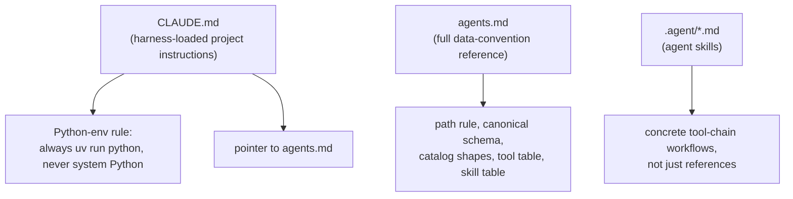

# Agentic usage

This repo is designed to be operated by Claude Code (or another
Claude-Agent-SDK-based coding agent) as much as by a human at a terminal.
This doc covers how that's wired up and how to extend it.

## The three files an agent reads first



- **`CLAUDE.md`** — auto-loaded into every Claude Code session in this repo.
  Kept short on purpose: the one hard rule (venv, never system Python) and a
  pointer to `agents.md` for everything else.
- **`agents.md`** — the terse, authoritative reference: layout, the
  provider-first path rule, canonical schema, catalog shapes, the tools
  table, and the agent-skills table. Treat this as source of truth; the
  `docs/` set expands on it with diagrams and worked examples but never
  contradicts it.
- **`.agent/*.md`** — one file per **skill**: a named, reusable workflow an
  agent can execute end-to-end (tool chain + standard invocations + gotchas),
  as opposed to `agents.md`'s reference-style tables.

## Skills currently defined

| Skill | File | Covers |
|---|---|---|
| `crypto_download` | [`.agent/crypto_download.md`](../.agent/crypto_download.md) | Identify stale/missing crypto data → download via freqtrade → merge without duplicates → keep YAML in sync |

See [`docs/workflows.md#crypto-refresh`](workflows.md#crypto-refresh) for the
same workflow with a diagram.

## Driving this repo with an agent

Typical prompts and what the agent should reach for:

| You ask | Agent should |
|---|---|
| "Refresh binance daily and 4h data" | Run the `crypto_download` skill: `check_gaps.py` → `download_crypto.py` → `query.py` |
| "Is anything stale?" | `tools/check_gaps.py --all` (crypto) — note it doesn't cover stocks/indexes yet |
| "Add SOL/USDT going back to 2020" | `download_crypto.py --pairs SOL/USDT --full --since 2020-01-01` across the timeframes you need |
| "Pull fresh sp500 intraday bars from IBKR" | Confirm TWS/Gateway is running first, then `download_ibkr_stock_overnight.py --universe sp500 ...` |
| "Some IBKR symbols failed overnight" | `retry_ibkr_failed_sequentially.py`, reading `tmp/ibkr_stock_download_progress_*.json` |
| "Does everything match the canonical schema?" | `check_schema.py`, then `convert_crypto.py` for any crypto mismatches |
| "What's the market cap of the top 20 alts monthly?" | `download_market_caps.py --all-active --frequency monthly --top-n 20 ...` |

For anything not covered by an existing tool, an agent should read
`agents.md`'s conventions (path rule, canonical schema, catalog shape) before
writing new code — those rules are non-negotiable, not suggestions.

## Working with the importable API instead of the CLI

Agents building new tools, one-off analysis, or notebook-style scripts
should import rather than shell out:

```python
from utils.data import load_assets, asset_path, load_ohlcv
from utils.catalog import (
    load_crypto_catalog, load_stock_catalog,
    normalize_ohlcv, update_stock_timeframe_entry, read_parquet_range,
)
from utils.gaps import detect_gaps, audit_exchange

assets = load_assets()                          # merged, symbol-keyed dict
path = asset_path("AAPL", "1d", provider="IBKR") # resolves flat or nested shape
df = load_ohlcv(path)
```

Never construct `price-data/` paths by hand — always go through
`asset_path()`, `crypto_file_path()`, `stock_file_path()`, etc., so the
provider-first rule can't be violated by accident.

## Permissions for tool-using agents

`.claude/settings.json` in this repo pre-allows read access to
`price-data/`'s subdirectories and a couple of IBKR documentation domains for
`WebFetch`, so an agent doesn't need to re-prompt for permission on routine
reads. Write operations (downloads, conversions, catalog updates) are not
pre-allowed — that's intentional, since those touch real data files.

## Extending: adding a new tool

1. Place the script in `tools/`, shebang `#!/usr/bin/env -S uv run python`.
2. Import path helpers from `utils/catalog.py` / `utils/data.py` — don't
   hand-roll paths.
3. Route all writes through `normalize_ohlcv()` before touching parquet.
4. Add a row to the Tools table in `agents.md`, and (if it's a common task)
   a section in [`docs/cli-reference.md`](cli-reference.md).
5. Run `tools/check_schema.py` after first use to confirm you didn't
   introduce a schema drift.

## Extending: adding a new agent skill

1. Add a file under `.agent/`, following the shape of
   [`.agent/crypto_download.md`](../.agent/crypto_download.md): what it
   covers, the tool chain as a diagram/list, standard invocations, key facts
   an agent needs (naming conventions, gotchas), caveats.
2. Register it in `agents.md`'s Agent Skills table.
3. Add a workflow section to [`docs/workflows.md`](workflows.md) if the
   skill represents a common end-to-end task, so both humans and agents have
   a single place to look it up.
