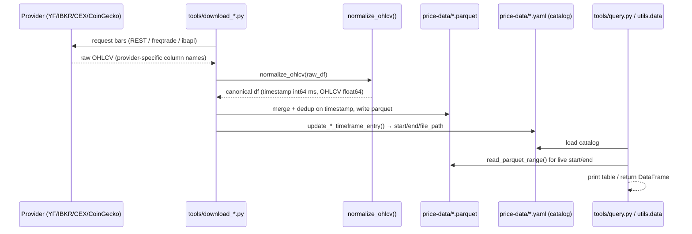
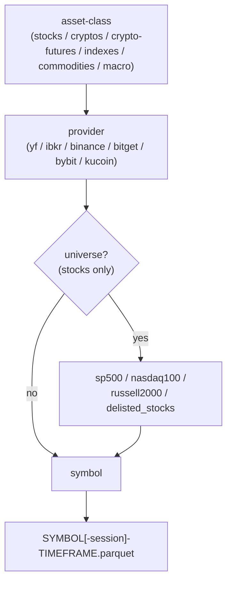
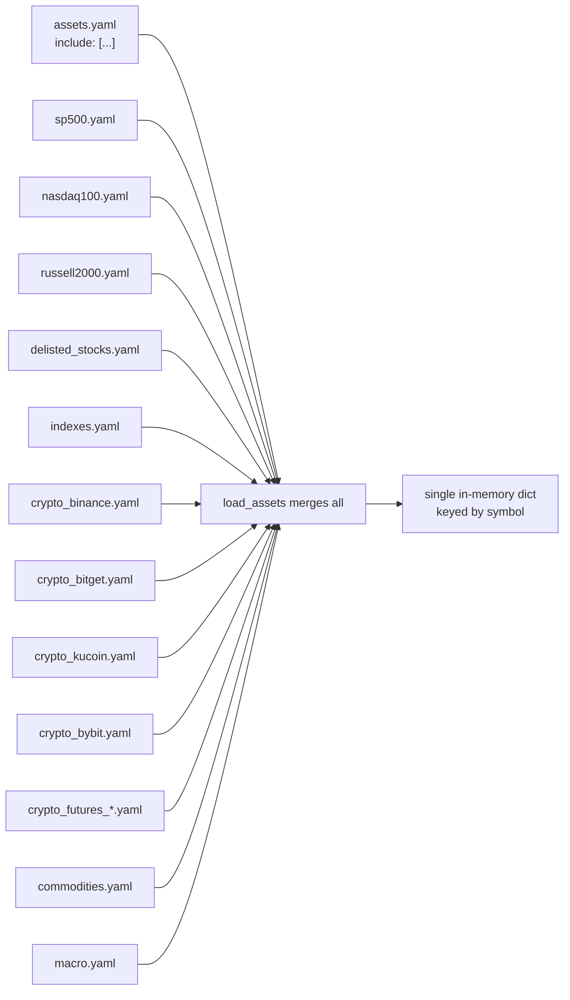
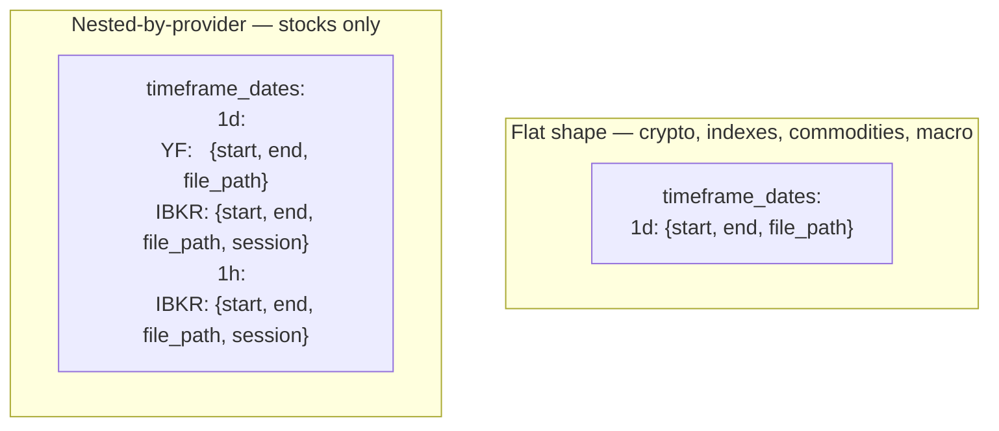
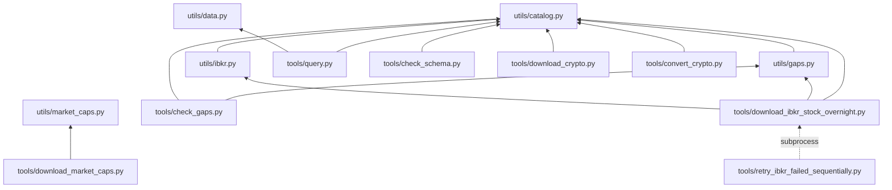

# Architecture

## Overview

This repo has three layers:

1. **`tools/`** — standalone CLI scripts, one process per invocation, no
   shared state beyond the files they read/write.
2. **`utils/`** — importable modules with no CLI of their own. They own the
   canonical schema, the catalog read/write logic, and gap detection.
3. **`price-data/`** — a symlink to `../price-data/`, the actual data root:
   parquet files plus YAML catalogs that index them.

Everything downstream (notebooks, trading research, agent skills) reads
`price-data/` through `utils/data.py` or `utils/catalog.py` — never by
guessing paths directly, since the path shape differs by asset class (see
below).

## Data flow



Every download tool converges on the same normalization step — `raw
provider output never touches disk directly`. `tools/check_schema.py` exists
specifically to catch a tool that skipped this step.

## Repository layout

```
ai-data-manager/
├── .agent/
│   └── crypto_download.md        # agent skill: gap-check → download → verify
├── docs/                         # this documentation set
├── tools/
│   ├── query.py                  # read: assets, timeframes, staleness
│   ├── check_gaps.py             # read: crypto gap/staleness audit
│   ├── check_schema.py           # read: canonical-schema conformance audit
│   ├── download_crypto.py        # write: freqtrade → parquet + catalog
│   ├── convert_crypto.py         # write: bulk-normalize legacy files
│   ├── download_market_caps.py   # write: CoinGecko snapshots/history
│   ├── download_ibkr_stock_overnight.py  # write: IBKR bars → parquet + catalog
│   ├── retry_ibkr_failed_sequentially.py # write: re-run IBKR failures one at a time
│   └── migrate_price_data_layout.py      # one-off: 2026-07 provider-first migration
├── utils/
│   ├── catalog.py                # canonical schema, catalog CRUD, path builders
│   ├── data.py                   # load_assets(), asset_path(), load_ohlcv()
│   ├── gaps.py                   # detect_gaps(), audit_exchange() (crypto)
│   ├── ibkr.py                   # ibapi wrapper, chunking, throttling
│   └── market_caps.py            # CoinGecko client, universe resolution
├── price-data/ -> ../price-data/
│   ├── assets.yaml                        # master index (include: [...])
│   ├── {sp500,nasdaq100,russell2000,delisted_stocks}.yaml
│   ├── crypto_{binance,bitget,bybit,kucoin}.yaml
│   ├── crypto_futures_{binance,bybit,kucoin}.yaml
│   ├── {indexes,commodities,macro}.yaml
│   ├── stocks/{yf,ibkr}/<universe>/<SYMBOL>/<SYMBOL>[-<session>]-<TF>.parquet
│   ├── cryptos/<exchange>/<symbol>/<symbol>-<TF>.parquet
│   ├── crypto-futures/<exchange>/<symbol>/<symbol>-<TF>.parquet
│   ├── indexes/yf/<SYMBOL>/<SYMBOL>-1d.parquet
│   ├── commodities/yf/<SYMBOL>/<SYMBOL>-1d.parquet
│   ├── macro/yf/<SYMBOL>/<SYMBOL>-1d.parquet
│   └── market-cap/coingecko/{exports,history,reference}/
├── CLAUDE.md
├── agents.md
└── pyproject.toml
```

## Provider-first path rule

Every asset class follows exactly one path shape, provider always first
under the class directory:

```
<asset-class>/<provider>[/<universe>]/<symbol>/<symbol>[-<session>]-<timeframe>.parquet
```



- `universe` exists only for stocks.
- `session` (`all` / `overnight`) exists only for IBKR intraday stock data.
- Never write one provider's data into another provider's path, and never
  let one provider's catalog write clobber another provider's registration
  for the same `(symbol, timeframe)` — see the catalog shapes below.

## Catalog resolution

`assets.yaml` is not itself the full registry — it's an include list that
`utils.data.load_assets()` merges at read time:



`market-cap/` is deliberately **not** included — it holds snapshot/ranking
exports, not per-symbol OHLCV series, so it doesn't fit the symbol-keyed
registry shape.

## Two catalog shapes

Stocks are the one asset class where two providers (YF, IBKR) can register
the *same* `(symbol, timeframe)`. Every other class has exactly one provider
per timeframe. The YAML shape reflects that:



`utils.catalog.update_stock_timeframe_entry()` writes into the nested shape
and can never clobber a sibling provider's node, because they're different
dict keys. `utils.data.asset_path()` transparently handles both shapes so
callers don't need to know which one a given asset class uses.

## Module dependency graph



`utils/market_caps.py` deliberately has no dependency on `utils/catalog.py`
— market-cap data isn't part of the symbol catalog (see above).
