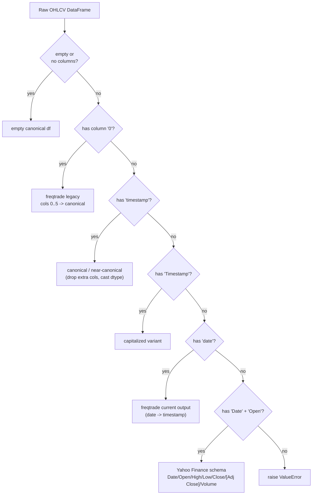

# Data model

## Canonical OHLCV schema

Every OHLCV-shaped asset class — crypto, crypto-futures, stocks (YF and
IBKR), indexes, and commodities — is stored on disk in exactly this parquet
schema:

| Column | dtype | Notes |
|---|---|---|
| `timestamp` | `int64` | Unix time in **milliseconds**, UTC |
| `open` | `float64` | |
| `high` | `float64` | |
| `low` | `float64` | |
| `close` | `float64` | |
| `volume` | `float64` | Base-asset volume |

Rules (never break these — enforced by `tools/check_schema.py`):

- No extra columns (`date`, `Adj Close`, `0`-`5`, `Timestamp`, etc.) survive
  past ingestion.
- No JSON files under `price-data/cryptos/` — convert immediately with
  `tools/convert_crypto.py`.
- New data **must** pass through `normalize_ohlcv()` before it's written.
- An empty parquet file (zero columns) is tolerated — it marks a failed
  download, not a schema violation.

**One documented exception**: `macro/yf/WTB3MS` is a plain interest-rate
series (`Value` in a `DatetimeIndex`), not OHLCV. Don't push it through
`normalize_ohlcv()` or `read_parquet_range()`.

## `normalize_ohlcv()` input shapes

`utils/catalog.py::normalize_ohlcv()` recognizes five raw shapes and maps
all of them to the canonical one, first match wins:



Output is always deduped on `timestamp` and sorted ascending. Datetime
columns are cast via `datetime64[ms]` rather than assumed-nanosecond, so
mixed-resolution inputs (e.g. pandas' default `datetime64[us]`) don't get
silently corrupted by a naive divide.

## Catalog YAML: two shapes

All per-class catalogs (`crypto_binance.yaml`, `sp500.yaml`, etc.) are YAML
dicts keyed by symbol, with `categories`, `timeframes`, and
`timeframe_dates`. There are two shapes for `timeframe_dates`, and which one
applies depends entirely on whether more than one provider can register the
same `(symbol, timeframe)`.

### Flat shape — crypto, crypto-futures, indexes, commodities, macro

Exactly one provider per `(symbol, timeframe)`, so no collision is possible:

```yaml
BTC_USDT:
  name: BTC_USDT
  common_name: BTC/USDT
  provider: binance
  categories: [Crypto]
  timeframes: [1d, 4h, 1h]
  timeframe_dates:
    1d: {start_date: "2017-08-17", end_date: "2026-07-04", file_path: price-data/cryptos/binance/BTC_USDT/BTC_USDT-1d.parquet}
```

### Nested-by-provider shape — stocks only

YF and IBKR can both register data for the same symbol/timeframe (e.g. daily
bars from both), so `timeframe_dates[tf]` is itself a dict keyed by
provider:

```yaml
AAPL:
  timeframes: [1h, 4h, 1d]
  timeframe_dates:
    1d:
      YF:   {start_date: "1980-12-12", end_date: "2026-07-04", file_path: price-data/stocks/yf/sp500/AAPL/AAPL-1d.parquet}
      IBKR: {start_date: "2024-01-02", end_date: "2026-07-04", file_path: price-data/stocks/ibkr/sp500/AAPL/AAPL-all-1d.parquet, session: all}
    1h:
      IBKR: {start_date: "2024-01-02", end_date: "2026-07-04", file_path: price-data/stocks/ibkr/sp500/AAPL/AAPL-all-1h.parquet, session: all}
```

Write these with `utils.catalog.update_stock_timeframe_entry()` — never
manually flatten this back to one node per timeframe. It mutates the
catalog dict in place, appends the provider under `timeframe_dates[tf]`, and
recomputes the entry's top-level `start_date`/`end_date` across every
timeframe × provider pair.

`utils.data.asset_path(symbol, timeframe, provider=None)` reads *either*
shape transparently: if `timeframe_dates[tf]` has a `file_path` key
directly, it's flat; otherwise it's nested and `provider` selects the node
(or the first one found, if omitted).

## `assets.yaml`: the master index

`price-data/assets.yaml` doesn't hold entries itself — it's an include list:

```yaml
include:
  - sp500.yaml
  - nasdaq100.yaml
  - russell2000.yaml
  - delisted_stocks.yaml
  - indexes.yaml
  - crypto_binance.yaml
  - crypto_bitget.yaml
  - crypto_kucoin.yaml
  - crypto_bybit.yaml
  - crypto_futures_binance.yaml
  - crypto_futures_bybit.yaml
  - crypto_futures_kucoin.yaml
  - commodities.yaml
  - macro.yaml
```

`utils.data.load_assets()` reads this file, resolves every include relative
to `price-data/`, and merges them into one dict keyed by symbol.
`market-cap/` is intentionally not included — see below.

## Asset class coverage (symbol counts as of last scan)

| Class | Location | Format | Symbols |
|---|---|---|---|
| Stocks (YF) | `stocks/yf/<universe>/` | parquet | 503 + 110 + 1,917 + 27 (sp500/nasdaq100/russell2000/delisted) |
| Stocks (IBKR) | `stocks/ibkr/<universe>/` | parquet | subset of the above, intraday + daily |
| Crypto | `cryptos/<exchange>/` | parquet | 435 (binance) / 796 (bitget) / 94 (bybit) / 908 (kucoin) |
| Crypto-futures | `crypto-futures/<exchange>/` | parquet | 71 (binance) / 71 (bybit) / 74 (kucoin) |
| Indexes | `indexes/yf/` | parquet | 11 — DJI, GSPC, IXIC, NDX, RUT, VIX… |
| Commodities | `commodities/yf/` | parquet | 1 — GC=F (Gold) |
| Macro | `macro/yf/` | parquet | 1 — WTB3MS (not OHLCV-shaped) |
| Market-cap | `market-cap/coingecko/` | parquet/csv | not per-symbol; snapshot + history exports, not in `assets.yaml` |

Reproduce these counts:

```bash
uv run python -c "
import yaml
for f in ['sp500','nasdaq100','russell2000','delisted_stocks','indexes',
          'commodities','macro','crypto_binance','crypto_bitget',
          'crypto_bybit','crypto_kucoin','crypto_futures_binance',
          'crypto_futures_bybit','crypto_futures_kucoin']:
    d = yaml.safe_load(open(f'price-data/{f}.yaml')) or {}
    print(f, len(d))
"
```

## Providers and freqtrade naming

Crypto downloads go through freqtrade, which uses its own pair/timeframe
naming that `utils/catalog.py` translates at the boundary:

| Concept | Our convention | Freqtrade convention |
|---|---|---|
| Pair separator | `BTC_USDT` | `BTC/USDT` |
| Monthly timeframe | `1Mo` | `1M` |
| Catalog key (non-binance) | `BTC_USDT_bitget` | n/a |
| Futures symbol | `BTC_USDT` (settlement stripped) | `BTC/USDT:USDT` |

`pair_to_symbol()`, `symbol_to_pair()`, `ft_timeframe()`, `our_timeframe()`,
`futures_pair_to_symbol()`, `futures_pair_to_ft_symbol()` in
`utils/catalog.py` are the only places this translation should happen.
