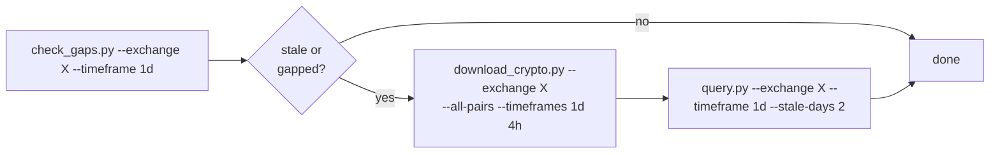
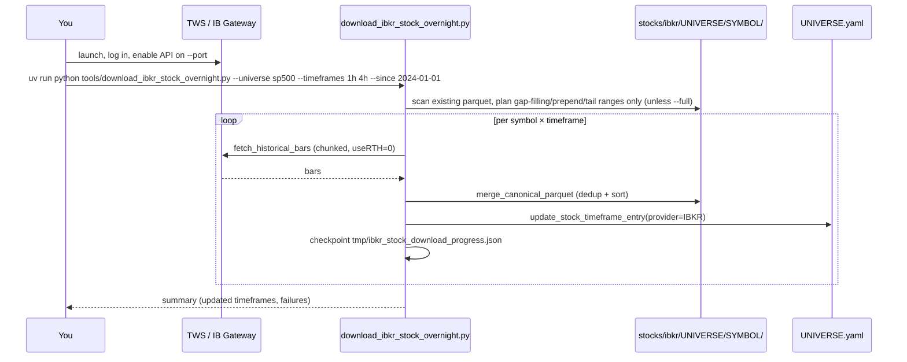
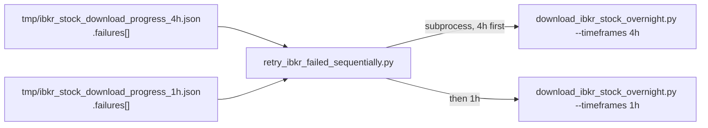
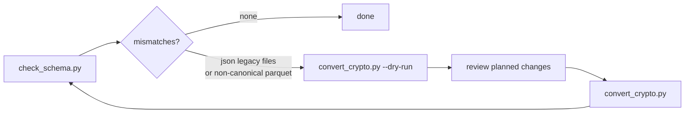

# Workflows

End-to-end walkthroughs for the tasks this repo is built around. Each links
back to the relevant [`docs/cli-reference.md`](cli-reference.md) entries.

## Crypto refresh

The everyday task: bring one exchange's catalog up to date.



```bash
# 1. Check what's stale on binance (1d timeframe)
uv run python tools/check_gaps.py --exchange binance --timeframe 1d

# 2. Append new data for all binance pairs (1d + 4h)
uv run python tools/download_crypto.py --exchange binance --all-pairs --timeframes 1d 4h

# 3. Verify
uv run python tools/query.py --exchange binance --timeframe 1d --stale-days 2
```

This is also codified as the `crypto_download` agent skill — see
[`docs/agentic-usage.md`](agentic-usage.md) and
[`.agent/crypto_download.md`](../.agent/crypto_download.md).

## Onboard a brand-new crypto symbol

```bash
uv run python tools/download_crypto.py \
  --exchange binance \
  --pairs SOL/USDT \
  --timeframes 1d 4h 1h 15m \
  --full --since 2020-01-01
```

`--full` + `--since` tells the tool there's no existing file to append to —
it does a from-scratch historical pull. Follow with `check_schema.py` to
confirm the new parquet landed canonical.

## Backfill history for an existing symbol

```bash
uv run python tools/download_crypto.py \
  --exchange binance \
  --pairs BTC/USDT ETH/USDT \
  --timeframes 1d \
  --prepend --since 2017-01-01
```

`--prepend` only requests data *before* the file's current start —
existing rows are never re-fetched.

## IBKR stock intraday download



```bash
uv run python tools/download_ibkr_stock_overnight.py \
  --universe sp500 --timeframes 1h 4h --since 2024-01-01
```

Key behaviors:
- Connect TWS/IB Gateway **first**, matching `--host`/`--port`/`--client-id`.
- `useRTH=0` is always requested; `--session overnight` then filters to
  bars fully outside `09:30–16:00 America/New_York`.
- YF's daily entries are untouched — IBKR writes into its own
  `timeframe_dates[tf]["IBKR"]` node (see
  [`docs/data-model.md`](data-model.md#nested-by-provider-shape--stocks-only)).
- Use one connection at a moderate `--sleep-seconds` (0.3–1.0). IBKR's
  historical-data pacing limiter has caused both burst lockouts and
  multi-hour dead-connection hangs under aggressive parallel/high-rate use.

### Resuming after a partial run

The tool checkpoints to `tmp/ibkr_stock_download_progress.json` (a live
snapshot) and appends every event to `tmp/ibkr_stock_download_resume.jsonl`.
Re-running the same command picks up where it left off automatically —
it re-scans existing files and only plans the remaining ranges.

### Retrying only the symbols that failed



```bash
uv run python tools/retry_ibkr_failed_sequentially.py --port 4001 --timeframes 4h 1h
```

Runs one timeframe's failed-symbol set at a time, sequentially — never in
parallel — to avoid the pacing issues above.

## Market-cap snapshots

```bash
# Hand-picked coins, most-recent-year window
uv run python tools/download_market_caps.py \
  --symbols sol ada xrp doge --start 2025-07-01 --end 2026-06-01

# Monthly top-20 across the active universe, excluding BTC + stablecoins
uv run python tools/download_market_caps.py \
  --all-active --start 2025-07-01 --end 2026-06-01 --frequency monthly \
  --top-n 20 --exclude-ids bitcoin --exclude-stablecoins
```

Outputs go to `price-data/market-cap/coingecko/{exports,history,reference}/`
— deliberately outside `assets.yaml` (see
[`docs/data-model.md`](data-model.md#assetsyaml-the-master-index)). Without
`COINGECKO_PRO_API_KEY`, expect the ~365-day public-API history limit and
single-worker fetching.

## Schema audit and cleanup

Run after any bulk import, a new provider integration, or when something
looks off in `query.py`/`check_gaps.py` output:



```bash
uv run python tools/check_schema.py
# if it flags crypto files:
uv run python tools/convert_crypto.py --exchange <ex> --dry-run
uv run python tools/convert_crypto.py --exchange <ex>
uv run python tools/check_schema.py --path price-data/cryptos/<ex>
```

`check_schema.py` is read-only and covers crypto/crypto-futures/stocks/
indexes/commodities. `convert_crypto.py` is crypto-only — a schema mismatch
in stocks/indexes/commodities needs a targeted fix in the tool that wrote
it, not `convert_crypto.py`.

## One-off layout migration

Only relevant if you're restructuring `price-data/` again the way the
2026-07 migration did. Run phases strictly in order, dry-run each first:

```bash
for phase in A B C D E F G; do
  uv run python tools/migrate_price_data_layout.py --phase $phase --dry-run
done
# review output, then repeat without --dry-run, one phase at a time
```

See [`docs/cli-reference.md`](cli-reference.md#migrate_price_data_layoutpy)
for what each phase does.
